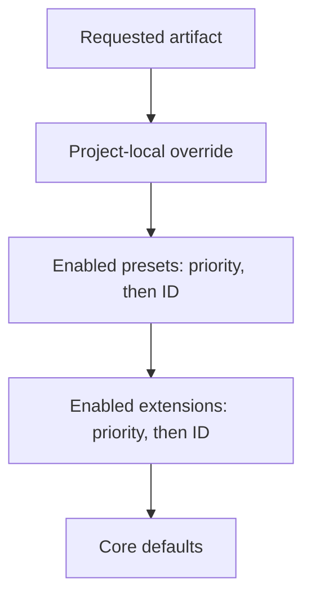

# Preset API reference

This reference defines the preset manifest, composition and delivery rules,
and installed state. The CLI reference documents terminal commands; the
developing guide walks through creating a package.

## Manifest

A preset has a UTF-8 `preset.yml` whose root is a YAML mapping.

| Field | Required | Contract |
| --- | --- | --- |
| `schema_version` | Yes | String `"1.0"` |
| `preset` | Yes | Metadata mapping |
| `preset.id` | Yes | String matching `[a-z0-9-]+` |
| `preset.name` | Yes | Human-readable string |
| `preset.version` | Yes | Quoted string accepted by Python `packaging.version.Version` |
| `preset.description` | Yes | Description string |
| `preset.author` | No | Author metadata |
| `preset.repository` | No | Repository URL metadata |
| `preset.license` | No | License metadata |
| `requires` | Yes | Requirements mapping |
| `requires.speckit_version` | Yes | Non-empty string; checked as a PEP 440 specifier during installation |
| `requires.extensions` | No | List of extension IDs or dependency mappings |
| `provides` | Yes | Contribution mapping |
| `provides.templates` | Yes | Non-empty list of contribution mappings, including commands and scripts |
| `tags` | No | Discovery tags; use a list of lowercase strings |

Use descriptive, letter-leading, lowercase-hyphenated IDs and `X.Y.Z`
versions for published presets. The community submission contract is
stricter than the runtime manifest validator: it requires an ID matching
`[a-z][a-z0-9-]*`, a numeric `X.Y.Z` version, and repository, documentation,
license, and release information. Runtime metadata validation alone is not
proof that a preset meets catalog submission requirements.

Quote versions and constraints: YAML values such as `version: 1.0` are
numbers, not version strings. Incompatible Spec Kit versions or invalid
Spec Kit specifiers fail installation.

### Contribution fields

Every item in `provides.templates` uses this shape:

```yaml
provides:
  templates:
    - type: "template"
      name: "spec-template"
      file: "templates/spec-addendum.md"
      description: "Adds team requirements"
      strategy: "append"
```

| Field | Required | Contract |
| --- | --- | --- |
| `type` | Yes | `template`, `command`, or `script` |
| `name` | Yes | Logical artifact name; not the source filename |
| `file` | Yes | Relative path within the preset, with no parent traversal |
| `description` | No | Contribution description |
| `strategy` | No | Defaults to `replace`; accepted strings are normalized to lowercase |

Template and script names use lowercase letters, digits, and hyphens.
Command names additionally permit dots; use names such as `speckit.specify`
or `speckit.myext.report`. Duplicate `(name, type)` pairs are rejected,
although different types can share a name.

The manifest's `file` is authoritative when an artifact is declared. A
missing or non-file declared path does not fall back to a different
conventional file in that same preset. Keep all declared files present:
manifest structural validation is not a complete package-content check.
Legacy lookup can use conventional paths when a manifest is absent or does
not declare the requested name.

### Extension dependencies

```yaml
requires:
  speckit_version: ">=0.9.0"
  extensions:
    - "companion-extension"
    - id: "other-extension"
      version: ">=1.2.0,<2"
      required: false
```

A bare ID means required with no version constraint. Mapping entries
require an `id` matching `[a-z0-9-]+`; optional `version` must be a non-empty
valid PEP 440 specifier, and `required` must be a boolean, defaulting to
`true`. Exact pins, exclusions, and upper bounds are valid.

Dependencies are advisory, not automatically installed. After installation,
the CLI warns about required extensions that are missing, have corrupt
registry entries, have missing files, are disabled, or have a comparable
version that does not satisfy the constraint. Missing or disabled
capabilities remain unavailable. A version mismatch does not disable the
extension; it can still run and behave differently than expected.

Optional dependencies are never warned about. Unparseable or missing
recorded versions are uncomparable, not reported as mismatches. An extension
directory admitted by the resolver without a registry entry is treated as
available, but has no recorded version to compare. An unreadable extension
registry prevents this post-install dependency inspection; no warning is
not proof that dependencies were verified.

Declare dependencies in the manifest, not just a catalog entry: `--dev` and
`--from` do not consult catalogs. A self-contained namespaced replacement
command is still delivered without its similarly named extension.

## File resolution

Each `(name, type)` is evaluated independently:



Within the preset and extension layers, lower priority numbers win, then
alphabetical IDs break ties. Disabled entries are excluded. Safe
unregistered extension directories participate at implicit priority `10`;
disabled, corrupt, or missing registered extensions are not re-admitted as
unregistered contributions.

| Type | Project-local override | Conventional preset subdirectory |
| --- | --- | --- |
| Template | `.specify/templates/overrides/<name>.md` | `templates/`, with legacy root lookup |
| Command | `.specify/templates/overrides/<name>.md` | `commands/` |
| Script | `.specify/templates/overrides/scripts/<name>.<ext>` | `scripts/` |

Core lookup includes project defaults and packaged core assets, or the
repository assets for editable/source installations. Command lookup can
map `speckit.<stem>` to the core `<stem>.md` filename. This allows composing
against core commands even when a project does not have a
`.specify/templates/commands/` copy.

### Composition strategies

| Type | `replace` | `prepend` | `append` | `wrap` |
| --- | --- | --- | --- | --- |
| Template | Default | Supported | Supported | `{CORE_TEMPLATE}` |
| Command | Default | Supported | Supported | `{CORE_TEMPLATE}` |
| Script | Default | Not supported | Not supported | `$CORE_SCRIPT` |

A highest-precedence `replace` layer wins entirely. Otherwise, resolution
finds the nearest lower `replace` base and applies only the layers above it,
bottom-up. Prepend and append separate the two contents with a blank line.
The wrapper placeholder is replaced with the effective lower content,
which may already contain other preset customizations.

Without a `replace` base, composition cannot produce output. Command
registration warns and skips an uncomposable command rather than requiring
an extension based solely on its namespace. A wrapper missing its required
placeholder raises a preset validation error during composition.

Composed command bodies do not embed every layer's YAML frontmatter.
Resolution uses the highest-priority available frontmatter and inherits
`scripts`, `agent_scripts`, and `argument-hint` from the base when absent.
The internal `strategy` key is removed from composed output. The active
integration then renders the result in its supported command or skill
format.

## Command and skill lifecycle

Installation copies preset files into `.specify/presets/<id>/` and records
the preset before composing its commands. Initial registration and
post-install reconciliation materialize the effective stack, so install
order does not determine the final winning command.

For initialized projects, delivery targets the recorded active integration
only. Skills mode emits skills rather than a second command representation
for command-backed integrations; native skill integrations use their
native format. The generic integration does not register preset overrides.
Switching with `specify integration use <key>` or `switch <key>` rescaffolds
enabled presets for the newly active integration.

Legacy projects with no `init-options.json` retain detection-based command
registration. An existing but corrupt or malformed options file does not
trigger that all-agent fallback.

Removal cleans up recorded outputs and reconciles surviving preset,
extension, override, or core contributions. It can restore affected command
or skill outputs in previously active integration directories recorded by
the removed preset as well as the current integration. Enable, disable, and
priority changes update resolution state but do not themselves rescaffold
already delivered commands or skills.

The constitution lifecycle is distinct from agent command delivery. By
default the constitution is resolved by the constitution command, not
rewritten on every stack change. With `constitution-sync` enabled, guarded
reconciliation uses generated-content provenance to avoid overwriting an
authored constitution.

## Installed state

| Location | Role |
| --- | --- |
| `.specify/presets/<id>/preset.yml` | Installed manifest |
| `.specify/presets/<id>/` | Copied package files |
| `.specify/presets/.registry` | JSON registry with `schema_version: "1.0"` and a `presets` mapping |
| `.specify/presets/.cache/` | Catalog cache and download working files |
| `.specify/memory/.constitution-template.json` | Generated constitution provenance when materialized |

Registry metadata records the version, manifest hash, enabled state,
priority, installation timestamp, source, and registered command/skill
outputs. Modern output tracking maps integration keys to lists of names;
legacy skill tracking can be a flat list. Treat this as CLI-managed state,
not the package manifest or the stable JSON inspection API.

Catalog installs record `{"kind":"catalog","catalog":"<name>"}` provenance.
Local directories, direct URLs, and locally bundled installs are recorded
as local rather than as a reusable download URL. Registry updates preserve
the existing `installed_at`; remove-then-add replacement creates a new one.

## Implementation map

The Python implementation is the
[`src/specify_cli/presets/` package](https://github.com/github/spec-kit/tree/main/src/specify_cli/presets):
`_manifest.py` validates manifests; `_registry.py` tracks installations;
`_manager.py`, `_manager_commands.py`, and `_manager_skills.py` own lifecycle
and output reconciliation; `_resolver.py` resolves and composes content;
`_catalog.py` and `_catalog_versions.py` handle discovery and releases.
`command_*.py` modules and `catalog/command_*.py` expose the CLI.

Shared command rendering lives in
[`agents.py`](https://github.com/github/spec-kit/blob/main/src/specify_cli/agents.py)
and the integration packages. Bash `resolve_template` /
`resolve_template_content` and PowerShell `Resolve-Template` /
`Resolve-TemplateContent` in the respective `common` scripts expose template
resolution to shell consumers. Agent command and skill materialization is
handled in Python, not independently by each agent.

## See also

- [Preset overview](overview.md)
- [CLI reference and JSON output](cli.md)
- [Developing presets](developing.md)
- [Catalog schemas and configuration](catalogs.md)
- [Publishing presets](publishing.md)
- [Artifact inventory and composition stacks](../overview/artifacts.md)
- [Integration management](../integrations/cli.md)
