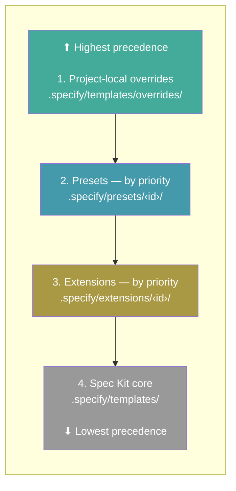
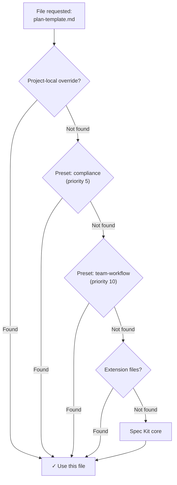

# Presets

Presets customize how Spec Kit works — overriding templates, commands, and terminology without changing any tooling. They let you enforce organizational standards, adapt the workflow to your methodology, or localize the entire experience. Multiple presets can be stacked with priority ordering.

## Search Available Presets

```bash
specify preset search [query]
```

| Option     | Description          |
| ---------- | -------------------- |
| `--tag`    | Filter by tag        |
| `--author` | Filter by author     |

Searches all active catalogs for presets matching the query. Without a query, lists all available presets.

## Install a Preset

```bash
specify preset add [<preset_id>]
specify preset add <preset_id> --version <version>
```

| Option                | Description                                                          |
| --------------------- | -------------------------------------------------------------------- |
| `--dev <path>`        | Install from a local directory (for development)                     |
| `--from <url>`        | Install from a custom URL instead of the catalog                     |
| `--version <version>` | Select an exact release from the winning catalog (ID installs only) |
| `--priority <N>`      | Resolution priority (default: 10; lower = higher precedence)        |

Installs a preset from the catalog, a URL, or a local directory. Preset commands
are automatically registered with supported active AI coding agent integrations.
The generic integration currently delivers extension invocations but does not
register preset command or skill overrides.
`--version` cannot be combined with `--from` or `--dev`. Direct URL installs
remain independent of catalog lookup. Without `--version`, installation still
selects the advertised current release (or the locally bundled preset). A
requested release absent from the winning catalog is an error; lower-priority
catalogs cannot supply it. Discovery-only catalogs cannot install any release.
Version-specific catalog installs verify the selected archive's `preset.yml` ID
and version before modifying installed presets. Historical releases require a
SHA-256 digest, which is also verified on download; a legacy current release
may omit the digest.

> **Note:** All preset commands require a project already initialized with `specify init`.

## Update a Preset

```bash
specify preset update <preset_id> [--from <url>] [--dev <path>] [--priority <N>]
```

Replaces an already-installed preset by running the normal `preset remove`
operation first and then the normal `preset add` operation. `--from`, `--dev`,
and `--priority` are forwarded to `preset add`; `--from` and `--dev` cannot be
combined. Without an explicit source, add resolves the preset through its usual
bundled and catalog lookup.

Update is deliberately destructive. Arguments are checked before anything is
removed: `--from` and `--dev` cannot be combined, `--priority` must be 1 or
higher, and the preset must already be installed. Beyond those checks the
replacement source itself is not inspected in advance. If removal succeeds but
replacement installation fails, the previous preset has already been removed.
The command reports a copy-pastable `specify preset add` retry command,
including the replacement source and priority. On Windows, the reported command
is explicitly formatted for PowerShell. There is no source pre-flight,
version comparison, manifest diff, staging, rollback, automatic repair, or
recovery transaction. A missing or invalid replacement source can therefore
leave the preset removed. With
`--from` or `--dev`, the replacement manifest's `preset.id` is not checked
against the requested ID before removal; a source declaring a different ID may
therefore install a different preset after the requested one has been removed.

A successful update follows normal remove and add behavior: it re-enables the
preset, recreates `installed_at`, removes local modifications tracked by the
preset, and treats an explicit `--from` or `--dev` as an intentional source
change. If constitution synchronization is enabled, both normal reconciliation
passes run. If add fails after removal, a generated constitution may remain
reconciled against the stack without the removed preset. The generated-file
guard still protects a hand-edited `.specify/memory/constitution.md`. No
update-specific constitution optimization is applied, so the normal remove and
add passes may rewrite the generated constitution even when the final resolved
content is unchanged.

## Remove a Preset

```bash
specify preset remove <preset_id>
```

Removes an installed preset and cleans up its registered commands.

## List Installed Presets

```bash
specify preset list
specify preset list --json
```

Lists installed presets with their versions, descriptions, template counts, and current status.

`--json` writes a JSON array to stdout. Every item has the keys `id`, `name`,
`description`, `version`, `author`, `priority`, `enabled`, `source`, and
`provides`. `author` is `null` when absent; `source` is `{"kind":"local"}`
for local, legacy, or malformed provenance, or
`{"kind":"catalog","catalog":"<catalog-name>"}` for a valid catalog source.
Preset `provides` contains `commands`, `templates`, and `scripts` counts. On
success, `--json` writes exactly one array to stdout and exits 0. A runtime
failure after option parsing writes exactly one `{"error":"..."}` object to
stderr and exits 1. If parsing raises a usage error and the raw `--json` token
is present, it writes that JSON error object to stderr and preserves the usage
exit code (normally 2). Without `--json`, including for help, the existing
human-readable behavior is unchanged.

Presets are printed in **resolution/precedence order**: the highest-precedence preset (lowest priority number) is listed first, and ties on priority are broken alphabetically by preset id. This matches the order used when composing commands and resolving templates, so the top entry is the one that wins for overlapping files.

## Preset Info

```bash
specify preset info <preset_id>
specify preset info <preset_id> --versions
specify preset info <preset_id> --json
```

Shows detailed information about an installed or available preset, including its templates, metadata, and tags.
`--versions` lists the advertised current version followed by historical
catalog versions, even for discovery-only entries; listing does not make
them installable. This view consults the catalog rather than the installed
preset.

`--json` describes one installed preset, matched by ID, and writes a single
JSON object to stdout. The object has the same `id`, `name`, `description`,
`version`, `author`, `priority`, `enabled`, and `source` keys as the matching
`specify preset list --json` item. In place of the `provides` counts it has
`commands`, `templates`, and `scripts` arrays, one entry per manifest
contribution in declaration order. Each entry has `name`, `description` (`""`
when absent or empty), `source` (`{"layer": "preset", "presetId": "<id>"}`, the
preset that provides it; the top-level `source` is where it was installed
from), `sourcePath` (the manifest
`file`, relative to the preset directory), and `strategy` (`replace`,
`prepend`, `append`, or `wrap`; `replace` when the manifest omits it). `--json`
cannot be combined with `--versions` (usage error, exit 2). A preset that is
not installed (including one that is only in a catalog), or a missing
project, writes one `{"error":"..."}` object to stderr and exits 1; usage errors
keep their exit code (normally 2), as with `list --json`.

## Resolve a File

```bash
specify preset resolve <name>
```

Shows which file will be used for a given name by tracing the full resolution stack. Useful for debugging when multiple presets provide the same file. When a layer was contributed by a `regex:` selector, the trace names the declaration that matched the requested name.

## Enable / Disable a Preset

```bash
specify preset enable <preset_id>
specify preset disable <preset_id>
```

Disable a preset without removing it. Disabled presets are skipped during file resolution but their commands remain registered. Re-enable with `enable`.

## Set Preset Priority

```bash
specify preset set-priority <preset_id> <priority>
```

Changes the resolution priority of an installed preset. Lower numbers take precedence. When multiple presets provide the same file, the one with the lowest priority number wins.

## Catalog Management

Preset catalogs control where `search` and `add` look for presets. Catalogs are checked in priority order (lower number = higher precedence).

> **A project's `.specify/preset-catalogs.yml` can point `add` and `search` at a catalog you didn't choose.** Before installing a preset in an unfamiliar project, run `specify preset catalog list` and inspect any catalog marked install-allowed — a project supplying that config, or marking a catalog install-allowed, is not evidence its presets were reviewed. Only mark a catalog `install_allowed` for one you authored or have vetted yourself; leave unfamiliar and community catalogs discovery-only.

### List Catalogs

```bash
specify preset catalog list
```

Shows all active catalogs with their priorities and install permissions.

### Add a Catalog

```bash
specify preset catalog add <url>
```

| Option                                       | Description                                        |
| -------------------------------------------- | -------------------------------------------------- |
| `--name <name>`                              | Required. Unique name for the catalog              |
| `--priority <N>`                             | Priority (default: 10; lower = higher precedence)  |
| `--install-allowed / --no-install-allowed`   | Whether presets can be installed from this catalog (default: discovery only). Only enable for a catalog you own and vet; never enable it for an unvetted public catalog. |
| `--description <text>`                       | Optional description                               |

Adds a catalog to the project's `.specify/preset-catalogs.yml`.

Re-adding the same named catalog with identical settings succeeds without changing the configuration; different settings are rejected.

### Remove a Catalog

```bash
specify preset catalog remove <name>
```

Removes a catalog from the project configuration.

### Catalog Resolution Order

Catalogs are resolved in this order (first match wins):

1. **Environment variable** — `SPECKIT_PRESET_CATALOG_URL` overrides all catalogs
2. **Project config** — `.specify/preset-catalogs.yml`
3. **User config** — `~/.specify/preset-catalogs.yml`
4. **Built-in defaults** — official catalog + community catalog

### Versioned catalog entries

Existing single-version entries remain valid: the top-level `version`,
`download_url`, optional `sha256`, and `requires` describe the advertised
current release. To retain older installable releases, add a `releases`
mapping keyed by version. Each historical record needs its own archive
`download_url` (HTTPS, or loopback HTTP for local development) and 64-digit
SHA-256 digest (optionally `sha256:`-prefixed, with surrounding whitespace);
other algorithm prefixes are rejected. Optional `requires` and `provides`
apply to that release instead of inheriting the current release's fields.
Other shared metadata, such as the name and description, is inherited.
Version keys must be distinct, including PEP 440-equivalent spellings, and
cannot repeat the current version.
Duplicate JSON keys are rejected before parsing can discard a release record.
Historical `requires.extensions` entries follow the preset manifest format:
extension IDs or mappings with an `id`, optional version constraint, and
optional boolean `required` flag.
For an ID lookup, catalogs are checked in priority order and stop at the
winning entry. Invalid or oversized payloads encountered before that entry
fail resolution rather than allowing a lower-priority entry to bypass its
installation policy. A malformed lower-priority source cannot block a valid
higher-priority match; searches across all sources still fail on malformed
catalogs. A non-object entry fails exact lookup for its own ID but is skipped
during all-catalog searches, which retain other valid entries. Unreachable
catalogs can still be skipped when another source is readable.
If every source fails, ID lookup (including `info --versions`) reports the
fetch error instead of claiming the preset has no catalog versions. Search
validates historical releases on each winning entry; invalid release history
from a shadowed source does not block its valid higher-priority replacement.

```json
{
  "presets": {
    "my-preset": {
      "name": "My Preset",
      "version": "2.0.0",
      "download_url": "https://example.com/my-preset-2.0.0.zip",
      "sha256": "<64 hex digits for the current archive>",
      "releases": {
        "1.5.0": {
          "download_url": "https://example.com/my-preset-1.5.0.zip",
          "sha256": "<64 hex digits for the older archive>",
          "requires": {"speckit_version": ">=0.8.0"}
        }
      }
    }
  }
}
```

The bundled community catalog stays discovery-only and need not publish
release histories. Bundle pin resolution is a separate capability; adding
these preset records alone does not make bundle pins installable.

Example `.specify/preset-catalogs.yml`:

```yaml
catalogs:
  - name: "my-org-presets"
    url: "https://example.com/preset-catalog.json"
    priority: 5
    install_allowed: true
    description: "Our approved presets"
```

## File Resolution

Presets can provide command files, template files (like `plan-template.md`), and script files. Each file name is evaluated independently against the priority stack, so different files can come from different layers.

Templates and scripts are looked up from the stack when Spec Kit needs them. Commands use the same stack for replacement and composition, but are materialized into the active integration's directory only, instead of being re-resolved by agents or written to every detected agent directory (#2948). During preset install, Spec Kit registers command files for the preset being installed against the currently active integration; post-install and post-removal reconciliation then recomputes and writes the effective command content for affected command names based on the active stack. Install and rescaffold remain active-only, but removal may also update previously targeted inactive directories recorded by the removed preset to restore the surviving command or skill layer. A non-active installed integration does not otherwise receive these command files until it becomes the default — `specify integration use <key>` (or `switch <key>`) rescaffolds enabled presets for the newly active integration. Agents do not re-resolve the stack each time they run a command.

By default, files use a **replace** strategy: the first match in the priority stack wins and is used entirely. Templates and commands can also use composition strategies: **prepend** places preset content before lower-priority content, **append** places it after lower-priority content, and **wrap** replaces `{CORE_TEMPLATE}` with lower-priority content. Scripts support **replace** and **wrap**; script wrappers use `$CORE_SCRIPT` as the placeholder.

### Regex Selectors

A `provides.templates` entry with `type: command` can match several commands with a `regex:` prefix on its `name`:

```yaml
provides:
  templates:
    - type: command
      name: 'regex:^speckit\.(plan|tasks|implement)$'
      file: commands/workflow-guidance.md
      strategy: append

```

An entry without the prefix keeps exact-name matching and is unaffected:

```yaml
provides:
  templates:
    - type: command
      name: speckit.plan
      file: commands/plan-guidance.md
      strategy: append
```

How selectors behave:

- `regex:` selectors are supported only for `command` declarations. Template and script declarations reject the prefix.
- A `name` beginning with `regex:` uses the bounded regular-expression syntax described below. The pattern is matched with **full-match** semantics against the logical command name (for example `speckit.plan`) — the same name you pass to `specify preset resolve` and see in `specify preset info`. It never matches file paths, directory names, or file extensions.
- A selector is eligible only against concrete resources provided by **lower layers** of the resolution stack: lower-priority presets, installed and enabled extensions, and Spec Kit core (including the bundled core pack in a wheel install). Project-local overrides and other `regex:` declarations are never matched, so selectors cannot chain off one another and cannot be satisfied by an override.
- Expansion preserves manifest declaration order, including overlapping exact and regex entries and declarations sharing the same file. Within each selector, concrete names are sorted.
- Every concrete resource a selector matches behaves exactly as though the preset contained a separate exact-name entry with the same `file` and `strategy`. One declaration therefore expands into zero, one, or several concrete resources.
- Matches are evaluated during resolution and existing registration points, including preset installation and active integration registration. Provider changes do not automatically refresh every previously generated match. Re-register affected presets with `specify integration use <key>` when their concrete providers change. Re-registration also retires tracked matches whose providers have disappeared.
- For `command` entries the matches are expanded to concrete command names **before** registration. Registration, composition, reconciliation, and cleanup all run against those concrete names; the literal `regex:...` string is never stored as a command name in the preset registry, an agent directory, or the `.composed` cache.
- Composition and priority are unchanged. `replace`, `prepend`, `append`, and `wrap` compose against the normal resolution stack, including when command declarations render as agent skills.

Zero-match and invalid patterns are handled as follows:

- A `regex:` selector that currently matches no lower-layer resource contributes nothing. Installing such a preset emits a warning unless an exact command declaration in the same preset satisfies the target name; it does **not** fail the installation.
- `specify preset info` lists each selector's current concrete matches nested beneath the declaration, or `No current matches` when there are none.
- `specify preset resolve <name>` attributes the layers it traces back to the declaration that matched, for example `sel-pack v1.0.0 → …/guidance.md (via regex:^speckit\.plan$)`, so a selector-driven resolution is visible in the stack trace and not only in `preset info`.

#### Regex selector safety boundaries

A `regex:` selector pattern is validated when a preset is installed, and again
whenever a selector is evaluated — including a selector found in a manifest that is
already on disk. Validation enforces these limits, and a pattern past one of them is
rejected with a `PresetValidationError` that names the limit it broke:

| Limit | Value |
| --- | --- |
| pattern length | 4096 characters after the `regex:` prefix |
| compiled states | 4096 |
| compiled edges | 2048 |
| resource name length | 1024 characters |

Matching never uses Python's backtracking engine. A selector is compiled to a state
machine whose work is bounded by `(resource name length + 1) × compiled edges`, so no
valid selector can make the CLI hang, however long or unlucky the resource name is.
The state and edge counts are capped separately because a branch reuses one entry
state for all of its alternatives: `(?:a|\B|\B|…){4000}` keeps the state count small
while producing millions of edges.

A selector found in a manifest that is already on disk — written by an older version,
or edited by hand — does not raise during resolution. It is reported with a warning
and treated as matching nothing, so an unsafe manifest cannot break unrelated
commands. Only the installation path fails hard.

The supported syntax is a subset of Python's regular expressions: literal characters
and escapes, `.`, character classes (`[a-z]`, `[^x]`), the predefined classes (`\d`,
`\w`, `\s` and their negations), grouping (`(...)`, `(?:...)`), alternation, the
anchors `^ $ \A \Z \b \B`, inline flags (`(?i)`, `(?i:...)`), and the quantifiers
`* + ? {m} {m,} {m,n}` including their lazy forms. The following are **refused**,
because their behaviour cannot be analysed from the parsed pattern alone or because
they are the shapes that make backtracking matchers hang:

- backreferences (`\1`) and named backreferences (`(?P=name)`);
- lookarounds (`(?=…)`, `(?!…)`, `(?<=…)`, `(?<!…)`);
- atomic groups (`(?>…)`) and possessive quantifiers (`a*+`);
- a repetition nested inside another repetition (`(a+)+`, `(a*)*`);
- a repetition whose body can match the empty string (`(a|)*`, `(?:)*`, `\B*`);
- an unbounded repetition over a zero-width alternation, such as `(a|a)*`, which the
  parser factorises into `a` followed by a branch whose alternatives are all empty.

Two similar-looking cases are deliberately treated differently:

- `(ab|a)*` and `(ba|b)*c` are **accepted**. The parser factorises the shared prefix
  out of the alternation, which leaves a branch with an empty alternative, but the
  repeated body still has to consume at least `a`/`b` in every alternative. It cannot match
  the empty string.
- `(a|a)*` is **refused**, because there the factorised branch has no non-empty
  alternative at all. The selector safety rule rejects that unbounded form.
- An invalid regular expression is rejected during manifest validation, so a preset with a malformed pattern fails to install with a clear validation error rather than at resolution time.

The resolution stack, from highest to lowest precedence:

1. **Project-local overrides** — `.specify/templates/overrides/`
2. **Installed presets** — sorted by priority (lower = checked first)
3. **Installed extensions** — sorted by priority
4. **Spec Kit core** — `.specify/templates/`

### Resolution Stack



Within each layer, files are organized by type:

| Type      | Subdirectory   | Override path                              |
| --------- | -------------- | ------------------------------------------ |
| Templates | `templates/`   | `.specify/templates/overrides/`            |
| Commands  | `commands/`    | `.specify/templates/overrides/`            |
| Scripts   | `scripts/`     | `.specify/templates/overrides/scripts/`    |

### Resolution in Action



### Example

```bash
specify preset add compliance --priority 5
specify preset add team-workflow --priority 10
```

For any file that both provide, `compliance` wins (priority 5 < 10). For files only one provides, that one is used. For files neither provides, the core default is used.

## FAQ

### Can I use multiple presets at the same time?

Yes. Presets stack by priority — each file is resolved independently from the highest-priority source that provides it. Use `specify preset set-priority` to control the order.

### How do I see which file is actually being used?

Run `specify preset resolve <name>` to trace the resolution stack and see which file wins.

### What's the difference between disabling and removing a preset?

**Disabling** (`specify preset disable`) keeps the preset installed but excludes it from future template and script resolution. Previously registered commands remain available in your AI coding agent until preset removal, so use removal when you need command changes to stop taking effect. Disabling is useful for temporarily testing template/script behavior without a preset, or comparing template/script output with and without it. Re-enable anytime with `specify preset enable`.

**Removing** (`specify preset remove`) fully uninstalls the preset — deletes its files, unregisters its commands from your AI coding agent, and removes it from the registry.

### Who maintains presets?

Most presets are independently created and maintained by their respective authors. The Spec Kit maintainers do not review, audit, endorse, or support preset code. Review a preset's source code before installing and use at your own discretion. For issues with a specific preset, contact its author or file an issue on the preset's repository.
