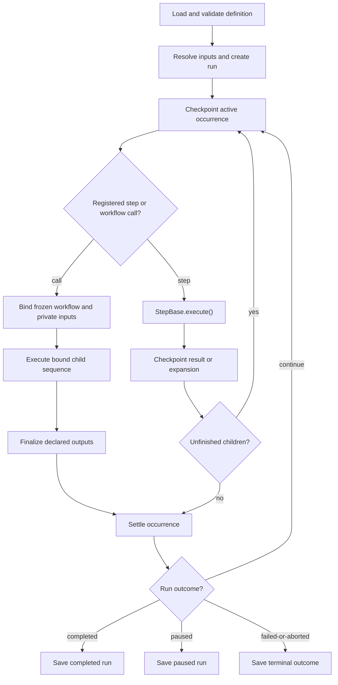
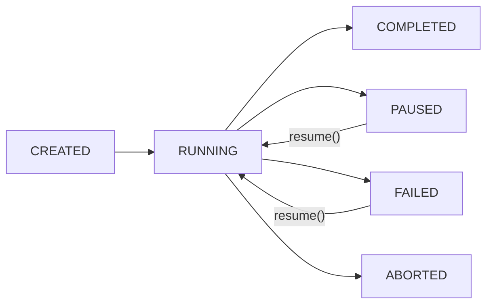

# Workflow API reference

This reference describes workflow YAML and execution/state semantics. The CLI's JSON run, status, and definition interfaces are documented in the command reference.

## Workflow YAML schema

| Field | Contract |
| --- | --- |
| `schema_version` | Version `1.0`; omitted defaults to `1.0` |
| `workflow` | Metadata and dispatch defaults |
| `workflow.id` | Lowercase letters/digits/hyphens, beginning and ending with a letter or digit; one-character IDs are valid |
| `workflow.name` | Required non-empty string |
| `workflow.version` | String in `X.Y.Z` form; omitted defaults to `0.0.0` |
| `workflow.author`, `workflow.description` | Descriptive metadata |
| `workflow.integration`, `workflow.model` | Optional string/null dispatch defaults |
| `workflow.options` | Optional mapping/null of dispatch options |
| `requires` | Optional mapping accepting `speckit_version` and `integrations` only |
| `inputs` | Mapping of input definitions |
| `outputs` | Mapping of declared workflow-call outputs |
| `steps` | Non-empty list of step definitions |

`requires` is advisory, not a sandbox or runtime permission gate. Unknown keys, including `requires.permissions`, are rejected. Workflow defaults do not cross a workflow-call boundary; map inputs explicitly when the child needs them.

Each output declares a `value` expression. Workflow-call results expose only declared JSON-safe values plus engine-owned status fields, not child inputs, internal step records, or logs.

## Input Types

Workflow inputs are type-checked and coerced from CLI string values:

```yaml
inputs:
  spec:
    type: string
    required: true
    prompt: "Describe what you want to build"
  task_count:
    type: number
    default: 5
  dry_run:
    type: boolean
    default: false
  scope:
    type: string
    default: "full"
    enum: ["full", "backend-only", "frontend-only"]
```

| Type | Accepts | Example |
|------|---------|---------|
| `string` | Any string | `"user-auth"` |
| `number` | Numeric strings → int/float | `"42"` → `42` |
| `boolean` | `true`/`1`/`yes` → `True`, `false`/`0`/`no` → `False` | `"true"` → `True` |

Number inputs preserve integer values and integer strings exactly, including values above `2**53`. Decimal/exponent strings use floating-point conversion, with whole-valued results stored as integers. Booleans, non-numeric values, and non-finite numbers are rejected. Required inputs must be supplied or prompted; defaults and enum membership are validated.

## Execution Model

When `specify workflow run` is invoked, it loads and validates the definition,
resolves inputs, and executes the root sequence. Registered steps and workflow
calls share occurrence lifecycle handling:



### Sequential Execution

Steps execute sequentially. Each step receives a `StepContext` containing resolved inputs, accumulated step results, and workflow-level defaults. After execution, the step's output is stored in `context.steps[step_id]` and made available to subsequent steps via expressions like `{{ steps.specify.output.file }}`.

### Nested Steps (Control Flow)

Steps like `if`, `switch`, `while`, and `do-while` return `next_steps`:
inline definitions that the engine records as child occurrences. Ordinary
nested branches share the surrounding expression context. Fan-out items
instead have independent contexts, and workflow calls bind private inputs and
defaults; their internal aliases do not enter the caller's context.

### State Persistence and Resume

The engine saves `RunState` to disk after each step, enabling resume from the exact point of interruption:



When a `gate` step pauses execution, the engine persists `current_step_index`
and all accumulated `step_results`. On `specify workflow resume <run_id>`, the
same executor replays completed occurrences into their contexts without
executing them, then continues at the unfinished occurrence.

New runs use a versioned execution tree. Each occurrence owns its result,
selected child sequences, and optional workflow binding. A binding stores the
target, frozen definition, private inputs, and `workflow_dir`; the called
workflow remains a private scope in the same run. Fan-out items have separate
contexts. Each occurrence, including a workflow call, is checkpointed as the
active step before its start is logged and before it executes, so status
reports it while it runs. Binding and selected expansions are
checkpointed before child side effects, results before an occurrence is done,
and logs after the checkpoint.
Legacy runs enter through their top-level index once. Inputs and tree
transitions share one atomic state checkpoint; the inputs file is a
compatibility mirror. A checkpoint failure prevents further writes by that
executor instance.

### Occurrence lifecycle

`Execution.step()` is the common runner for registered steps and workflow calls.
`execute_step()` and `workflow()` return a `StepResult`, a subtree outcome, or an
unknown-implementation failure. The runner alone performs `begin`, `finish`,
`settle`, and best-effort `leave` on exception unwinding; the phase and field
allow-lists in `transition()` reject invalid operations. The public, stateless
`StepBase.execute()` extension contract is unchanged.

All occurrence mutations pass through `Execution.transition()`. It checks the
allowed source phase and fields, derives the destination phase, validates the
candidate with the same node rules used on load, projects results, and saves
under the run lock. Callers cannot supply a destination phase.

| Operation | Meaning |
|-----------|---------|
| `begin` | Mark this occurrence active and checkpoint before `step_started` or its callback; a failed checkpoint leaves no start event. A blocked workflow call drops its previous attempt's result |
| `expand` / `bind` | Freeze children and their source before child execution |
| `rebind` / `iterate` | Persist updated binding or the next loop occurrence |
| `outputs` | Children finished; declared workflow outputs remain to finalize |
| `finish` / `settle` | Record an own-step result or subtree outcome; clear activity |
| `leave` | Clear activity on exception unwinding; the run handler saves the failure/pause |

`phase` identifies the continuation point, `active` identifies entered occurrences
(several may be active in a fan-out), and `outcome` identifies a subtree halt or
completion. A container's own result may be completed while its children are
paused. `current_step_id` is a compatibility status view updated as
occurrences are entered, rather than a resume cursor. Completion does not
reconcile this scalar; during parallel fan-out it may name an item that has
already finished, while the tree's per-occurrence `active` flags remain
authoritative.
Status reporting uses a bound call's recorded result when available. If an
interruption or exception leaves the active call unfinished without a result,
its scope inherits the run's paused or failed status; completed calls keep
their own recorded status.
A call's recorded result summarizes its previous attempt, so `begin` on a
blocked call drops `result`, `outcome`, and `error`: a bound call continues at
`children`, and a call whose binding failed returns to `ready` and binds again.
A leaf step's record describes that same step, such as a pending gate's prompt,
and remains until `finish` replaces it.

`notify()` emits events and callbacks only after the corresponding checkpoint.
Persistence is mandatory lifecycle behavior, not a listener. Existing container
events describe completion of their own expansion; calls finish after their
children and declared outputs. Completed replay emits neither events nor saves.
Entering an unfinished container on resume checkpoints activity without repeating
its expansion event.

Execution schema version 2 stores fan-out templates as shared YAML sources on
their parent occurrence. Raw `step_template` configuration is not published in
persisted step outputs. Frozen expansion results and aggregated `fan_results`
are separate: `result_view()` adds the aggregate for reporting and downstream
steps, while items always receive the frozen expansion view. This also preserves
YAML-native template scalars without putting them in JSON result records.

Resume validates tree structure, root snapshot, and the legacy offset together,
before any writes. The offset must be within the workflow and no later than the
saved root index. Legacy checkpoints without a tree still adapt once;
private, unreleased version-1 trees are rejected rather than silently interpreted
as the new format.

## Execution identity and resume

Each step occurrence owns a record in a persisted execution tree. An authored
step ID is a local expression alias, not a global execution ID. Fan-out items
have independent alias contexts and ordered item results. Public reporting uses
qualified occurrence IDs where needed, for example `fan:template:0` for a
fan-out item and `loop:step:1` for a later loop iteration. Qualified IDs are
not expression names. Fan-out item aliases are reporting-only: a `fan-in`
`wait_for` references declared step IDs, in particular the fan-out step's own
`id`, whose ordered item results are available as
`steps.<fan-out-id>.output.results`.

> **Migration note:** a fan-out's output no longer includes `step_template`.
> `steps.<fan-out-id>.output` and the fan-out's entry in a `fan-in`'s
> `output.results` contain `items`, `max_concurrency`, `item_count`, and
> `results`; the template is kept only in the private execution tree that runs
> the items. An expression such as `{{ steps.<fan-out-id>.output.step_template }}`
> now resolves to empty. Read the template from the fan-out's `step` in the
> workflow definition instead.

New runs persist selected branches, dynamic custom-step expansions, loop
iterations, and fan-out items. Resume retains completed work without
reevaluating already selected branches. Workflow targets and overlay-resolved
definitions remain bound even if installations change. An unbound call still
checks that its target is installed and enabled when execution reaches it.

Ordinary resume retains bound inputs. Explicit `--input` rebinds reached,
incomplete calls through their original mappings: newly mapped values override
the prior binding, while values not mapped again retain their bound values.
Completed calls retain their results. Failed output evaluation retries only
finalization, without repeating completed child commands.

Snapshots are stored as YAML strings inside the private JSON execution tree,
preserving YAML scalar types. Inputs and results remain JSON values. The
snapshot freezes workflow definitions and expansions, not files under
`context.workflow_dir` or step implementations; missing resources can still
cause ordinary step failures. Legacy runs without a tree enter through their
saved root index, then use tree-backed resume. Resume is available only for
runs in the `paused` or `failed` state.

`current_step_index` is the root-sequence index; `current_step_id` is a
compatibility occurrence-ID view updated as steps are entered. It is not an
exact active-step set: during parallel fan-out it may name an item that has
already completed. Qualified values include `fan:item:0` for a fan-out item
and `loop:body:1` for a later loop iteration.
Inside a workflow call, IDs are relative to the called workflow. Structured
run/status output includes `workflow_scopes`
summaries when calls exist and reports an active nested gate with its
`scope_path`. Private log events add `workflow_id` and `execution_path` to the
qualified `step_id`. A step emits completion after its checkpoint; containers
emit before their children, while replayed completed occurrences emit no step
events.

## Error Handling

By default, any step that returns `StepResult(status=StepStatus.FAILED, ...)`
at runtime halts the entire run — most commonly a `shell` or
`command` step exiting non-zero. Set `continue_on_error: true` on
a step to record its result and continue to the next sibling step
instead. When the failure was a non-zero exit, the exit code
remains available on `steps.<id>.output.exit_code` so a downstream
`if` or `switch` can branch on it (or a `gate` can surface it to
the operator via `{{ }}` interpolation in `message`):

```yaml
- id: heavy-thing
  type: command
  integration: claude
  command: speckit.heavy-thing
  continue_on_error: true

- id: check-result
  type: if
  condition: "{{ steps.heavy-thing.output.exit_code != 0 }}"
  then:
    - id: review
      type: gate
      message: "Step failed (exit {{ steps.heavy-thing.output.exit_code }}). Approve to run the recovery path, or reject to leave the failure recorded and move on."
      on_reject: skip
    - id: recover
      type: if
      condition: "{{ steps.review.output.choice == 'approve' }}"
      then:
        - id: rerun
          command: speckit.recovery
  else:
    - id: next-thing
      command: speckit.next-thing
```

A few things worth knowing about that example:

- Both gate options (`approve`, `reject`) return `StepStatus.COMPLETED`;
  `on_reject: skip` controls only whether the engine aborts on reject
  (it doesn't, with `skip`) — it does **not** auto-skip subsequent
  sibling steps in the `then:` list. Downstream branching is the
  workflow author's responsibility: read
  `{{ steps.<gate-id>.output.choice }}` in a follow-up `if`, `switch`,
  or expression, as the `recover` step above does.
- `on_reject` has three values: `abort` (default — reject → `StepStatus.FAILED`
  with `output.aborted = True`, halts the run), `skip` (reject →
  `StepStatus.COMPLETED`, author handles branching as shown), and `retry`
  (reject → `StepStatus.PAUSED` so the next `specify workflow resume` re-runs
  the gate).
- Gates do not automatically re-run the failed step. To express a
  retry path, either define custom gate options and branch on the
  choice downstream, or wrap the failing step in your own loop.

**Notes:**

- The field must be a literal boolean (`true` / `false`); coerced
  strings like `"true"` are rejected at validation time.
- **Scope: returned failures only.** The flag applies to step results
  with `status=StepStatus.FAILED`. Unhandled exceptions raised out of a step's
  `execute()` method are caught one level up by `WorkflowEngine.execute()`,
  logged as `workflow_failed`, and abort the run regardless of
  `continue_on_error`. If a step author wants the flag to cover an
  exceptional path, the step must catch the exception internally and
  return `StepResult(status=StepStatus.FAILED, ...)` with the failure encoded in
  `output` (e.g. `exit_code`, `stderr`, or a custom field).
- Gate aborts (`on_reject: abort` chosen by the operator) always halt
  the run — `continue_on_error` does not override them. The flag is
  for transient/expected step failures, not for overriding deliberate
  operator decisions.
- Structural validation runs up-front: `specify workflow run` rejects
  invalid workflow definitions before the run is created, so
  validation failures never reach this code path.
- When the flag is omitted or false, a returned failure stops the run.

## State and Resume

Each workflow run persists its state at `.specify/workflows/runs/<run_id>/`:

- `state.json` — current run state and step progress, including each step's
  output. Output captured with
  [`capture: true`](../workflow-steps/types.md#capturing-command-and-prompt-output) is stored here in
  plain text.
- `inputs.json` — resolved input values
- `log.jsonl` — step-by-step execution log

This enables `specify workflow resume` to replay completed occurrences and
continue at the unfinished occurrence where a run paused (for example, at a
gate) or failed.

## State and Configuration Locations

| Component | Location | Format | Purpose |
|-----------|----------|--------|---------|
| Workflow definitions | `.specify/workflows/{id}/workflow.yml` | YAML | Installed workflow definitions |
| Workflow registry | `.specify/workflows/workflow-registry.json` | JSON | Installed workflows metadata |
| Project overlays | `.specify/workflows/overlays/{id}/*.yml` | YAML | Project-local workflow edits |
| Run state | `.specify/workflows/runs/{run_id}/state.json` | JSON | Persisted execution state |
| Run inputs | `.specify/workflows/runs/{run_id}/inputs.json` | JSON | Resolved input values |
| Run log | `.specify/workflows/runs/{run_id}/log.jsonl` | JSONL | Append-only event log |
| Catalog cache | `.specify/workflows/.cache/*.json` | JSON | Cached catalog entries (1hr TTL) |
| Project catalogs | `.specify/workflow-catalogs.yml` | YAML | Project-level catalog sources |
| User catalogs | `~/.specify/workflow-catalogs.yml` | YAML | User-level catalog sources |

## Implementation map

| Source under `src/specify_cli/workflows/` | Responsibility |
| --- | --- |
| `__init__.py` | Workflow group registration |
| `command_*.py`, `mcp_*.py` | Transport adapters for shared operations |
| `engine.py`, `_execution.py`, `composition.py` | Definition validation, execution tree, workflow calls and resume |
| `base.py` | Shared run contracts |
| `expressions/` | Parsing, evaluation and filters |
| `catalog/`, `_catalog_cache.py` | Workflow discovery, releases, registry and cached catalog I/O |
| `overlay/` | Overlay validation, composition and resolution |

## See also

- [Workflow CLI and JSON contracts](cli.md)
- [Authoring and bundled example](developing.md)
- [Built-in step configuration](../workflow-steps/types.md)
- [Expressions](expressions.md)
- [Catalog schemas](catalogs.md)
- [Step Python API and registry](../workflow-steps/api.md)
