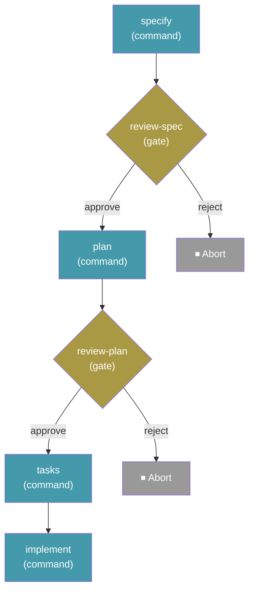

# Developing workflows

A workflow package contains a `workflow.yml` definition and any scripts, modules, or resources it references. Start with a small local definition, exercise success and failure paths, then package a versioned release.

## Package layout

```text
my-workflow/
├── workflow.yml
├── README.md
├── LICENSE
├── CHANGELOG.md
└── scripts/
```

A bare YAML file is enough for a simple workflow. Directory and archive installation preserve companion files; a raw YAML URL does not download adjacent repository files. Archives can contain the package at their root or inside one top-level directory.

Resolve companion files with `context.workflow_dir` or the shell's `SPECKIT_WORKFLOW_DIR`, not the caller's working directory.

## Bundled SDD example

Workflows are defined in YAML files. Here is the built-in **Full SDD Cycle** workflow that ships with Spec Kit:

```yaml
schema_version: "1.0"
workflow:
  id: "speckit"
  name: "Full SDD Cycle"
  version: "1.0.1"
  author: "GitHub"
  description: "Runs specify → plan → tasks → implement with review gates"

requires:
  speckit_version: ">=0.8.5"
  integrations:
    any:
      - "alquimia"
      - "claude"
      - "copilot"
      - "gemini"
      - "opencode"

inputs:
  spec:
    type: string
    required: true
    prompt: "Describe what you want to build"
  integration:
    type: string
    default: "auto"
    prompt: "Integration to use (e.g. claude, copilot, gemini; 'auto' uses the project's initialized integration)"

steps:
  - id: specify
    command: speckit.specify
    integration: "{{ inputs.integration }}"
    input:
      args: "{{ inputs.spec }}"

  - id: review-spec
    type: gate
    message: "Review the generated spec before planning."
    options: [approve, reject]
    on_reject: abort

  - id: plan
    command: speckit.plan
    integration: "{{ inputs.integration }}"
    input:
      args: "{{ inputs.spec }}"

  - id: review-plan
    type: gate
    message: "Review the plan before generating tasks."
    options: [approve, reject]
    on_reject: abort

  - id: tasks
    command: speckit.tasks
    integration: "{{ inputs.integration }}"
    input:
      args: "{{ inputs.spec }}"

  - id: implement
    command: speckit.implement
    integration: "{{ inputs.integration }}"
    input:
      args: "{{ inputs.spec }}"
```

This produces the following execution flow:



Run it with:

```bash
specify workflow run speckit -i spec="Build a kanban board with drag-and-drop task management"
```

## Test locally

```bash
specify workflow run ./workflow.yml --input key=value
specify workflow status <run_id>
specify workflow resume <run_id>
specify workflow add ./my-workflow --dev
specify workflow info my-workflow
```

`run` validates before execution and then executes the definition; it is not a dry-run validator. Use a disposable initialized project for examples that can modify files or invoke agents. There is no `specify workflow validate` command. `info` displays metadata and steps, not a complete safety review.

Cover valid and invalid inputs, gate verdicts and rejection policies, step failures, interrupted/failed resume, nested calls, and concurrent items when applicable. A completed step is not repeated on resume, but an uncheckpointed side effect can repeat; make external writes safe to retry.

## Custom step packages

Custom step types are installed with `specify workflow step`. A step is a
directory package containing metadata and executable Python:

```text
my-step/
├── step.yml        # required, at the package root
├── __init__.py     # required, at the package root
└── helpers.py      # optional nested modules and data files
```

To prepare a public package for community catalog intake, see
[Community Workflow Step Types](../community/workflow-steps.md).

`step.yml` declares the step's identity. `step.type_key` must exactly match the
`<step_id>` passed on the command line — the ID is never inferred from package
content:

```yaml
step:
  type_key: my-step
  name: My Step
  version: 0.1.0
  author: you
  description: What this step does
```

`__init__.py` must define a `StepBase` subclass whose `type_key` matches:

```python
from specify_cli.workflows.base import StepBase, StepResult


class MyStep(StepBase):
    type_key = "my-step"

    def execute(self, config, context):
        return StepResult(output={"ok": True})
```

### Package validation

Every source is validated identically before anything is committed:

- `step.yml` and `__init__.py` must be regular, non-symlink files at the package
  root.
- The package tree is copied recursively (relative imports, nested helper
  modules, and data files are supported). A symlinked package root, any
  descendant symlink, and any filesystem object that is not a regular file or
  directory are rejected.
- `.git`, `__pycache__`, and `.DS_Store` entries are skipped without being
  inspected: they are not copied, excluded directories are not entered, and
  they do not count toward any limit.
- The installed-package policy permits at most **512 retained entries** (files
  and directories combined), at most **32 levels** of directory nesting, and
  **50 MiB** of retained content.
- Archive URLs also pass transport/extraction safety limits before package
  validation: at most 512 archive entries, 50 MiB downloaded or extracted, and
  10 MiB per archive member. Catalog files have a 50 MiB per-response bound.
- Installation validates and copies the package but does **not** import or
  execute `__init__.py`. Installed custom step modules are loaded during startup
  of `workflow add`, `workflow run`, and `workflow resume`, before any particular
  custom step necessarily executes.

> **Security note:** Loading a custom step runs its Python with **your**
> privileges. Only install and retain step packages from sources you trust.

## Implement a custom step

Subclass `StepBase`, give the package and implementation the same `type_key`, and return explicit status, outputs, and errors. Override `validate()` and guard invalid configuration in `execute()` too: execution does not automatically call the validator.

The registry shares a single instance of each type. Concurrent fan-out can call it from several threads, so keep execution stateless and thread-safe; store per-run data in `config` and `context`, not `self`. Let the engine own checkpoints and lifecycle transitions.

Use `specify workflow step add my-step --dev ./my-step` for local iteration and `--force` after editing. See the [step installation reference](cli.md#step-management) for source validation and replacement failure behavior.

## Bundle-local limitation

A bundle's `provides.steps` still resolves only through the active step
catalogs. Bundle-local `steps/<id>/` payloads and relative
`provides.steps[].source` overrides are **not** resolved in this release, so
such steps are not installable offline. See the [bundle offline limits](../bundles/cli.md#offline-limits).

## Authoring practices

- Keep steps focused and place gates at meaningful decision points.
- Give inputs descriptive prompts, appropriate types, sensible defaults, and enums for fixed choices.
- Declare integration defaults and allow per-step overrides. `requires.integrations` documents expectations, not enforced permissions.
- Read prior-step outputs only after those steps have run; `default` handles null or empty text, not every possible expression error.
- Prefer strict shell steps with environment bindings for dynamic data. Document destructive operations, credentials, network calls, and other side effects. Gates do not make untrusted shell text safe.

## See also

- [Workflow YAML and step API](api.md)
- [Built-in step types](steps.md)
- [Expressions and shell safety](expressions.md)
- [Publishing workflows](publishing.md)
- [Community step submission](../community/workflow-steps.md)
