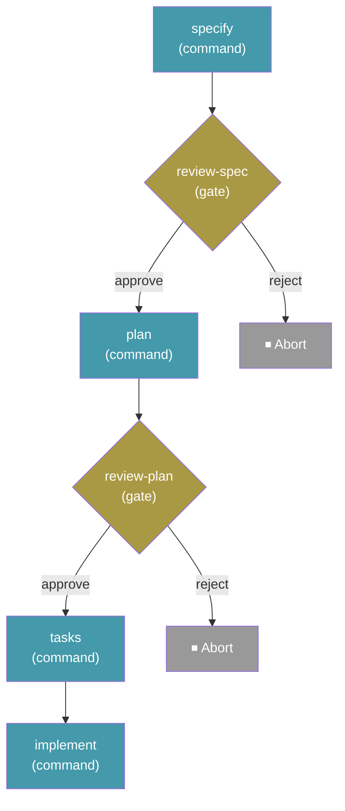

# Developing workflows

A workflow package contains a `workflow.yml` definition and any scripts, modules, or resources it references. Start with a small local definition, exercise success and failure paths, then package a versioned release.

## Package layout

```text
my-workflow/
├── workflow.yml
├── README.md
├── LICENSE
├── CHANGELOG.md
└── scripts/
```

A bare YAML file is enough for a simple workflow. Directory and archive installation preserve companion files; a raw YAML URL does not download adjacent repository files. Archives can contain the package at their root or inside one top-level directory.

Resolve companion files with `context.workflow_dir` or the shell's `SPECKIT_WORKFLOW_DIR`, not the caller's working directory.

## Verifying command completion

Command steps can opt into `verify_completion: true` with `capture: true`. The runner
appends an invocation-specific completion contract to the command arguments. The agent
must finish with one `SPECKIT_RESULT` line followed by a space and a JSON object with `nonce`,
`status: "completed"`, and a nonempty `artifacts` mapping from project-relative paths
to SHA-256 hashes. The runner validates that receipt and hashes the actual files before
returning `COMPLETED`; the parsed receipt is available as `output.completion`.

Paths must use forward slashes and remain inside the project; symlink paths are rejected.
Missing or duplicate receipts, blocked status, stale nonces, missing or empty files,
changed hashes, timeouts and truncated output fail the step even if the CLI exits zero.
Other command steps retain their existing exit-code behavior unless explicitly opted in.
Choose `timeout` and `capture_max_bytes` for the expected work. A blocked clarification
needs its missing answer supplied before resuming. Receipts verify reported completion
and output identity, not semantic correctness or file-ownership enforcement.

## Bundled SDD example

Workflows are defined in YAML files. Here is the built-in **Full SDD Cycle** workflow that ships with Spec Kit:

```yaml
schema_version: '1.0'
workflow:
  id: speckit
  name: Full SDD Cycle
  version: 2.0.0
  author: GitHub
  description: Eleven-stage design, coding, optional deployment and testing workflow
requires:
  speckit_version: '>=2.0.0.dev0'
  integrations:
    any:
    - alquimia
    - claude
    - codex
    - copilot
    - gemini
    - opencode
inputs:
  spec:
    type: string
    required: true
    prompt: Describe what you want to build
  integration:
    type: string
    default: auto
    prompt: Integration to use (e.g. claude, copilot, gemini; 'auto' uses the project's
      initialized integration)
  speckit_review_spec_verdict:
    type: string
    default: ''
  speckit_review_plan_verdict:
    type: string
    default: ''
  deploy:
    type: boolean
    default: false
    prompt: Deploy after coding? Requires compatible authorized destinations.
  deployment_target:
    type: string
    default: ''
    prompt: Destination references and authorized deployment scope; no secrets
steps:
- id: constitution
  command: speckit.constitution
  capture: true
  verify_completion: true
  timeout: 1800
  integration: '{{ inputs.integration }}'
  input:
    args: 'Preserve the existing constitution. If absent, establish project principles
      from: {{ inputs.spec }}'
- id: specify
  command: speckit.specify
  capture: true
  verify_completion: true
  timeout: 1800
  integration: '{{ inputs.integration }}'
  input:
    args: '{{ inputs.spec }}'
- id: review-spec
  type: gate
  verdict_input: speckit_review_spec_verdict
  message: Review product requirements before clarification and technical design.
  options:
  - approve
  - reject
  on_reject: abort
- id: clarify
  command: speckit.clarify
  capture: true
  verify_completion: true
  timeout: 1800
  integration: '{{ inputs.integration }}'
  input:
    args: '{{ inputs.spec }}'
- id: architecture
  command: speckit.architecture
  capture: true
  verify_completion: true
  timeout: 1800
  integration: '{{ inputs.integration }}'
  input:
    args: '{{ inputs.spec }}'
- id: environment
  command: speckit.environment
  capture: true
  verify_completion: true
  timeout: 1800
  integration: '{{ inputs.integration }}'
  input:
    args: '{{ inputs.spec }}'
- id: plan
  command: speckit.plan
  capture: true
  verify_completion: true
  timeout: 1800
  integration: '{{ inputs.integration }}'
  input:
    args: '{{ inputs.spec }}'
- id: review-plan
  type: gate
  verdict_input: speckit_review_plan_verdict
  message: Review implementation design before coding task generation.
  options:
  - approve
  - reject
  on_reject: abort
- id: taskscode
  command: speckit.taskscode
  capture: true
  verify_completion: true
  timeout: 1800
  integration: '{{ inputs.integration }}'
  input:
    args: '{{ inputs.spec }}'
- id: analyze
  command: speckit.analyze
  capture: true
  verify_completion: true
  timeout: 1800
  integration: '{{ inputs.integration }}'
  input:
    args: '{{ inputs.spec }}'
- id: impcode
  command: speckit.impcode
  capture: true
  verify_completion: true
  timeout: 1800
  integration: '{{ inputs.integration }}'
  input:
    args: '{{ inputs.spec }}'
- id: deploy-if-requested
  type: if
  condition: '{{ inputs.deploy }}'
  then:
  - id: deployment
    command: speckit.deployment
    capture: true
    verify_completion: true
    timeout: 1800
    integration: '{{ inputs.integration }}'
    input:
      args: '{{ inputs.deployment_target }}'
- id: test
  command: speckit.test
  capture: true
  verify_completion: true
  timeout: 1800
  integration: '{{ inputs.integration }}'
  input:
    args: Run local unit and isolated integration tests. Use deployment.md for target-dependent
      end-to-end tests if deployed; record unavailable targets as blocked.
```

This produces the following execution flow:



Run it with:

```bash
specify workflow run speckit -i spec="Build a kanban board with drag-and-drop task management"
```

## Test locally

```bash
specify workflow run ./workflow.yml --input key=value
specify workflow status <run_id>
specify workflow resume <run_id>
specify workflow add ./my-workflow --dev
specify workflow info my-workflow
```

`run` validates before execution and then executes the definition; it is not a dry-run validator. Use a disposable initialized project for examples that can modify files or invoke agents. There is no `specify workflow validate` command. `info` displays metadata and steps, not a complete safety review.

Cover valid and invalid inputs, gate verdicts and rejection policies, step failures, interrupted/failed resume, nested calls, and concurrent items when applicable. A completed step is not repeated on resume, but an uncheckpointed side effect can repeat; make external writes safe to retry.

## Authoring practices

- Keep steps focused and place gates at meaningful decision points.
- Give inputs descriptive prompts, appropriate types, sensible defaults, and enums for fixed choices.
- Declare integration defaults and allow per-step overrides. `requires.integrations` documents expectations, not enforced permissions.
- Read prior-step outputs only after those steps have run; `default` handles null or empty text, not every possible expression error.
- Prefer strict shell steps with environment bindings for dynamic data. Document destructive operations, credentials, network calls, and other side effects. Gates do not make untrusted shell text safe.

## See also

- [Workflow YAML and execution semantics](api.md)
- [Built-in step types](../workflow-steps/types.md)
- [Expressions and shell safety](expressions.md)
- [Publishing workflows](publishing.md)
- [Developing custom step packages](../workflow-steps/developing.md)
