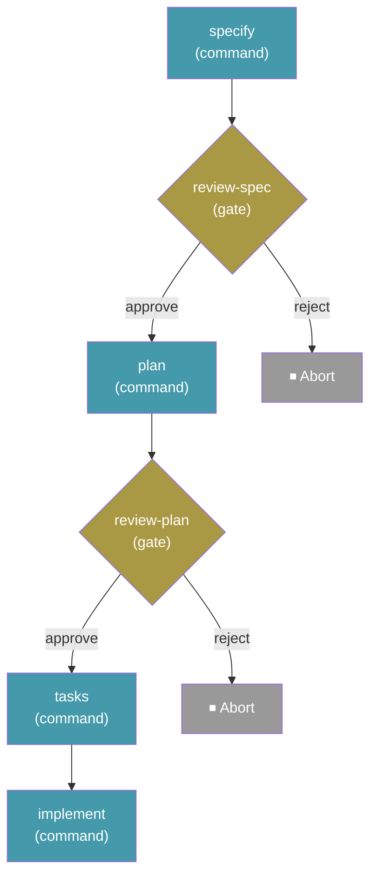

# Developing workflows

A workflow package contains a `workflow.yml` definition and any scripts, modules, or resources it references. Start with a small local definition, exercise success and failure paths, then package a versioned release.

## Package layout

```text
my-workflow/
├── workflow.yml
├── README.md
├── LICENSE
├── CHANGELOG.md
└── scripts/
```

A bare YAML file is enough for a simple workflow. Directory and archive installation preserve companion files; a raw YAML URL does not download adjacent repository files. Archives can contain the package at their root or inside one top-level directory.

Resolve companion files with `context.workflow_dir` or the shell's `SPECKIT_WORKFLOW_DIR`, not the caller's working directory.

## Bundled SDD example

Workflows are defined in YAML files. Here is the built-in **Full SDD Cycle** workflow that ships with Spec Kit:

```yaml
schema_version: "1.0"
workflow:
  id: "speckit"
  name: "Full SDD Cycle"
  version: "1.0.2"
  author: "GitHub"
  description: "Runs specify → plan → tasks → implement with review gates"

requires:
  speckit_version: ">=0.15.1"
  integrations:
    any:
      - "alquimia"
      - "claude"
      - "copilot"
      - "gemini"
      - "opencode"

inputs:
  spec:
    type: string
    required: true
    prompt: "Describe what you want to build"
  integration:
    type: string
    default: "auto"
    prompt: "Integration to use (e.g. claude, copilot, gemini; 'auto' uses the project's initialized integration)"
  speckit_review_spec_verdict:
    type: string
    default: ""
  speckit_review_plan_verdict:
    type: string
    default: ""

steps:
  - id: specify
    command: speckit.specify
    integration: "{{ inputs.integration }}"
    input:
      args: "{{ inputs.spec }}"

  - id: review-spec
    type: gate
    verdict_input: speckit_review_spec_verdict
    message: "Review the generated spec before planning."
    options: [approve, reject]
    on_reject: abort

  - id: plan
    command: speckit.plan
    integration: "{{ inputs.integration }}"
    input:
      args: "{{ inputs.spec }}"

  - id: review-plan
    type: gate
    verdict_input: speckit_review_plan_verdict
    message: "Review the plan before generating tasks."
    options: [approve, reject]
    on_reject: abort

  - id: tasks
    command: speckit.tasks
    integration: "{{ inputs.integration }}"
    input:
      args: "{{ inputs.spec }}"

  - id: implement
    command: speckit.implement
    integration: "{{ inputs.integration }}"
    input:
      args: "{{ inputs.spec }}"
```

This produces the following execution flow:



Run it with:

```bash
specify workflow run speckit -i spec="Build a kanban board with drag-and-drop task management"
```

## Test locally

```bash
specify workflow run ./workflow.yml --input key=value
specify workflow status <run_id>
specify workflow resume <run_id>
specify workflow add ./my-workflow --dev
specify workflow info my-workflow
```

`run` validates before execution and then executes the definition; it is not a dry-run validator. Use a disposable initialized project for examples that can modify files or invoke agents. There is no `specify workflow validate` command. `info` displays metadata and steps, not a complete safety review.

Cover valid and invalid inputs, gate verdicts and rejection policies, step failures, interrupted/failed resume, nested calls, and concurrent items when applicable. A completed step is not repeated on resume, but an uncheckpointed side effect can repeat; make external writes safe to retry.

## Authoring practices

- Keep steps focused and place gates at meaningful decision points.
- Give inputs descriptive prompts, appropriate types, sensible defaults, and enums for fixed choices.
- Declare integration defaults and allow per-step overrides. `requires.integrations` documents expectations, not enforced permissions.
- Read prior-step outputs only after those steps have run; `default` handles null or empty text, not every possible expression error.
- Prefer strict shell steps with environment bindings for dynamic data. Document destructive operations, credentials, network calls, and other side effects. Gates do not make untrusted shell text safe.

## See also

- [Workflow YAML and execution semantics](api.md)
- [Built-in step types](../workflow-steps/types.md)
- [Expressions and shell safety](expressions.md)
- [Publishing workflows](publishing.md)
- [Developing custom step packages](../workflow-steps/developing.md)
