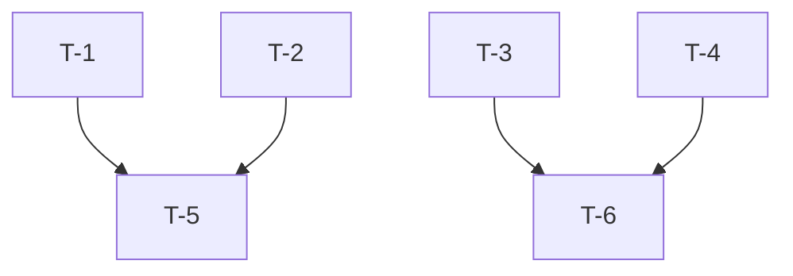

# Task List: {{feature_name}}

> **Status**: Draft
> **Based on**: `.specify/specs/{{feature_name}}/plan.md`
> **Kanban Board**: `hermes kanban list --assignee default`

## Tasks

### Parallel Group A [P:frontend]
- [ ] **T-1**: {{task_description}} [US#{{us_number}}]
- [ ] **T-2**: {{task_description}} [US#{{us_number}}]

### Parallel Group B [P:backend]
- [ ] **T-3**: {{task_description}} [US#{{us_number}}]
- [ ] **T-4**: {{task_description}} [US#{{us_number}}]

### Sequential
- [ ] **T-5**: {{task_description}} [US#{{us_number}}]
- [ ] **T-6**: {{task_description}} [US#{{us_number}}]

## Dependencies

## Constitution Gates

Each task must pass:
- [ ] Purpose alignment
- [ ] Principle compliance
- [ ] Architecture fit
